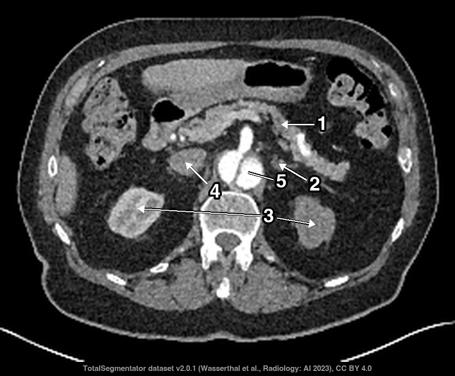
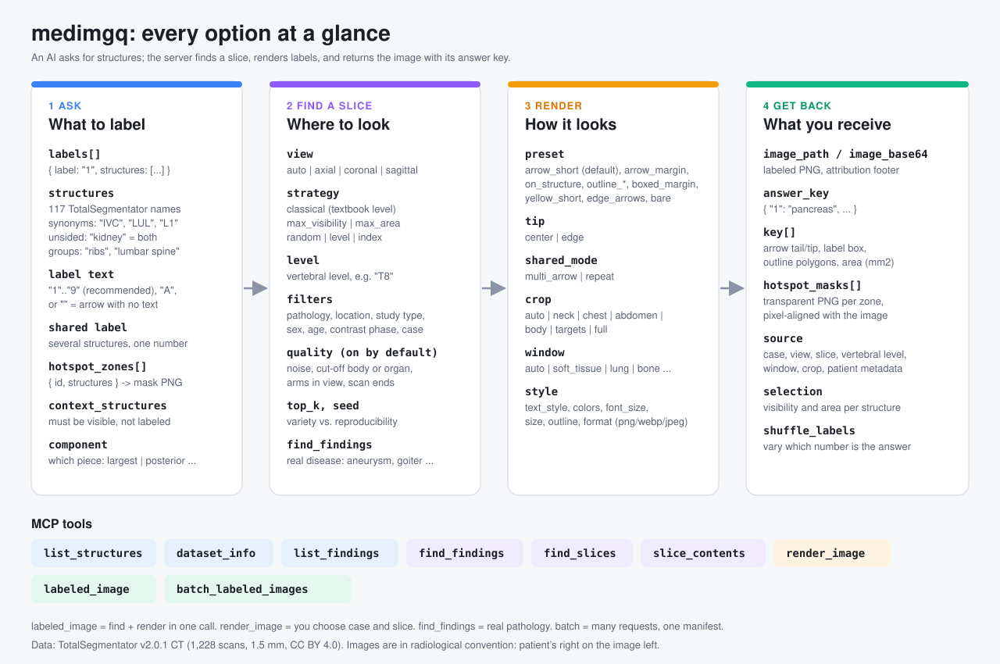
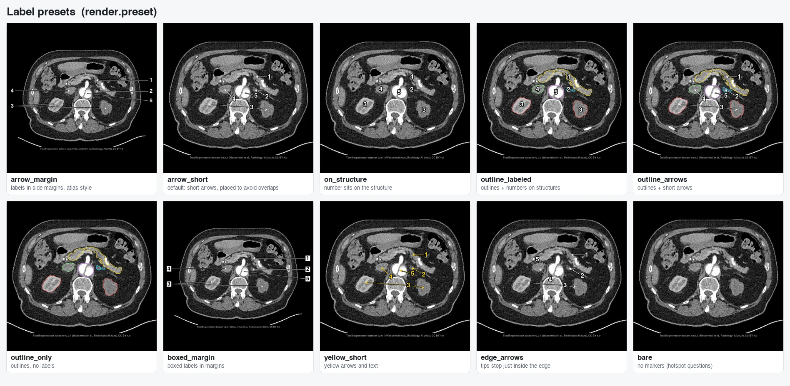
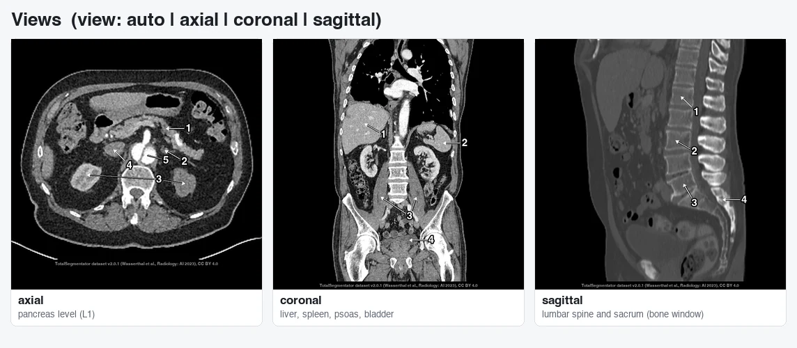
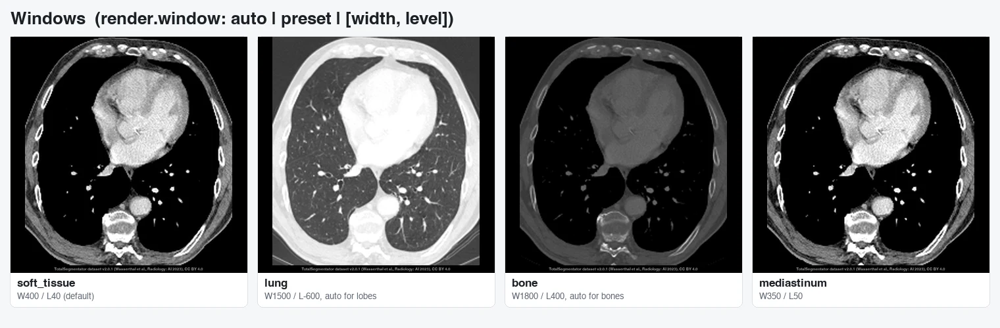
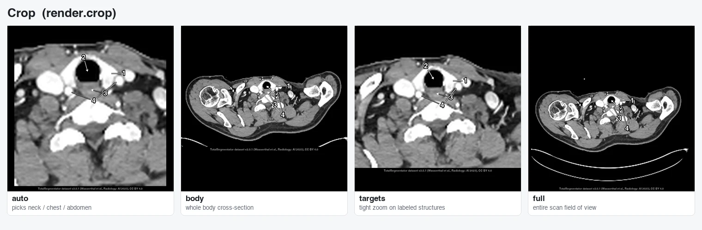
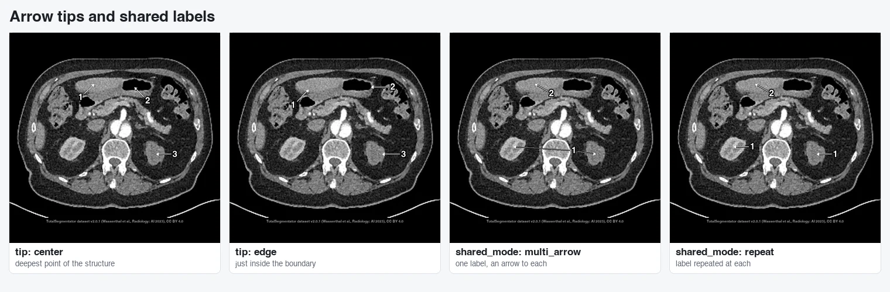
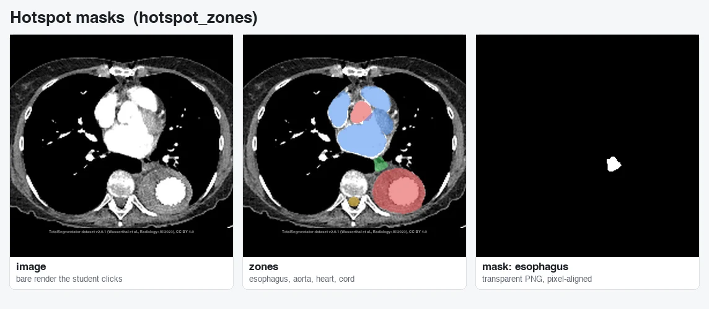
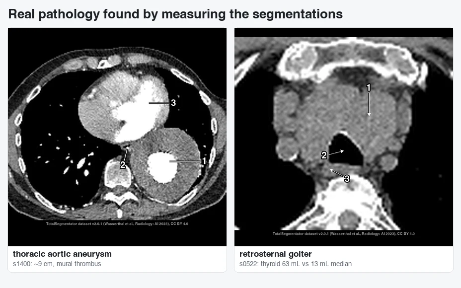

# medimgq: labeled CT images for exam questions

An [MCP](https://modelcontextprotocol.io) server that lets an AI build **image questions for medical-school
practice exams**. The AI asks for structures ("label the pancreas, the left adrenal gland and both
kidneys"); medimgq finds a real CT slice where they are all clearly visible, draws numbered arrows, and
returns the image together with an **answer key**. It can also export **click-the-structure (hotspot)
masks** that line up exactly with the image.

<p align="center"></p>

Images come from the [TotalSegmentator dataset](https://zenodo.org/records/10047292): 1,228 real CT scans,
each with expert-reviewed outlines of 117 structures. CT comes first; X-ray and MRI are planned.

> If you are an AI agent, read [`ai_read_this.md`](ai_read_this.md) instead. It is the same information in
> a form built for tool use.

---

## Contents

- [How it works](#how-it-works)
- [Setup](#setup)
- [Connect it to an AI](#connect-it-to-an-ai)
- [What you can ask for](#what-you-can-ask-for)
- [Options, with pictures](#options-with-pictures)
- [What comes back](#what-comes-back)
- [The seven tools](#the-seven-tools)
- [Examples](#examples)
- [Real pathology](#real-pathology)
- [Limits and caveats](#limits-and-caveats)
- [Project layout and development](#project-layout-and-development)
- [Data and attribution](#data-and-attribution)

---

## How it works



1. **Ask.** The AI names the structures to label. Names are forgiving: `"IVC"`, `"inferior vena cava"` and
   `"postcava"` all work; `"kidney"` means both kidneys; `"lumbar spine"` means L1–L5.
2. **Find a slice.** medimgq searches a precomputed index of every structure on every slice of every scan.
   By default it uses the textbook view and vertebral level (the pancreas at L1, the thyroid at C6–T1) and
   skips noisy scans, cut-off anatomy and arms in the field of view.
3. **Render.** It draws numbered arrows, placed so they don't cover other labeled structures or each other,
   picks a sensible window (lung window for lung lobes) and crops to the right region (neck, chest or
   abdomen).
4. **Get back.** A PNG, an answer key such as `{"1": "pancreas", "2": "left kidney, right kidney"}`, the
   exact pixel geometry of every arrow and label, and optional hotspot masks.

The AI writes the question itself. medimgq only supplies the images and the facts about them.

---

## Setup

You need Python 3.12+, [uv](https://docs.astral.sh/uv/), about 30 GB of disk for the dataset, and a few
minutes to build the index.

```bash
git clone https://github.com/agadin/medical-image-question-creator.git
cd medical-image-question-creator
uv sync
```

**1. Download the data** (not included in this repo). Put it in the project folder, or point
`MEDIMGQ_TS_ROOT` at it.

- [TotalSegmentator dataset v2.0.1](https://zenodo.org/records/10047292) → unzip to `Totalsegmentator_dataset_v201/`

**2. Build the indexes** (one time):

```bash
uv run python -m medimgq.indexer --workers 12   # ~4 min: every structure on every slice
uv run python -m medimgq.quality --workers 12   # ~4 min: noise, contrast phase, cut-off body, arms
```

They are written to `data/index/` (about 160 MB).

**3. Check it works:**

```bash
uv run pytest            # starts the server over stdio and calls every tool
```

| Environment variable | Default | Purpose |
|---|---|---|
| `MEDIMGQ_TS_ROOT` | `./Totalsegmentator_dataset_v201` | dataset location |
| `MEDIMGQ_INDEX_DIR` | `./data/index` | index location |
| `MEDIMGQ_OUTPUT_DIR` | `./outputs` | where images go when no `output_dir` is given |
| `MEDIMGQ_BLOCKLIST` | `./qc/blocklist.csv` | cases a reviewer has rejected |

---

## Connect it to an AI

**Claude Code**

```bash
claude mcp add medimgq -- uv run --directory /path/to/medical-image-question-creator medimgq-mcp
```

**Claude Desktop** and other MCP clients: add this to the client's MCP config.

```json
{
  "mcpServers": {
    "medimgq": {
      "command": "uv",
      "args": ["run", "--directory", "/path/to/medical-image-question-creator", "medimgq-mcp"]
    }
  }
}
```

Then ask your AI something like: *"Make a CT question where the student has to recognize the left
brachiocephalic vein. Use numbers on the image and add four distractors."*

---

## What you can ask for

- **Any of 117 structures**: abdominal and pelvic organs, lung lobes, heart and great vessels, neck vessels,
  thyroid, trachea, esophagus, every vertebra C1–S1, every rib, major muscles and bones. Ask the
  `list_structures` tool for the full list with synonyms.
- **Several structures per label.** `{"label": "2", "structures": ["kidneys"]}` puts one number on both
  kidneys.
- **Unlabeled arrows.** A label of `""` draws an arrow with no text ("What is the structure at the arrow?").
- **Bare images with hotspot masks** for click-the-structure questions.
- **Patients by filter**: pathology category (tumor, vascular, trauma, inflammation, …), body region, scan
  type, sex, age, estimated contrast phase, or a specific case.

---

## Options, with pictures

All images below are real output. They can be regenerated with `uv run python scripts/make_docs_images.py`.

### Label style: `render.preset`



| Preset | Use it for |
|---|---|
| `arrow_short` **(default)** | Most questions. Short arrows placed to avoid covering other structures and labels. |
| `arrow_margin` | Atlas-style figures: labels line up in the margins. |
| `on_structure` | Compact images where the number sits on the structure. |
| `outline_labeled`, `outline_arrows` | Easier questions; the outline shows the structure's shape. |
| `outline_only` | "Name the outlined structure" questions. |
| `boxed_margin`, `yellow_short` | Style variants. |
| `edge_arrows` | Arrow tips stop just inside the structure's edge. |
| `bare` | No markers. Use with hotspot masks. |

Every part of a preset can be overridden on its own: `marker`, `tip`, `outline`, `shared_mode`,
`text_style` (`halo` / `boxed` / `boxed_dark`), `marker_color`, `text_color`, `font_size`, `size`
(longest side in pixels, default 768) and `format` (`png` / `webp` / `jpeg`).

### View: `view`



`auto` picks each structure's textbook view: axial for most organs, coronal for lung lobes and long bones,
sagittal for vertebrae and the spinal cord. You can always force one.

### Window: `render.window`



`auto` uses the lung window when any lung lobe is labeled, the bone window when most targets are bones, and
soft tissue otherwise. Presets: `soft_tissue`, `abdomen`, `liver`, `mediastinum`, `lung`, `bone`, `brain`,
`angio`, or any `[width, level]` pair.

### Crop: `render.crop`



`auto` picks a region from the slice: **neck** (shoulders cut away), **chest** (arms cut away) or
**abdomen** (whole trunk). You can force `neck`, `chest` or `abdomen`, or use `body`, `targets` (tight zoom)
or `full`. A labeled structure is never cropped out.

### Arrow tips and shared labels: `render.tip`, `render.shared_mode`



### Hotspot masks: `hotspot_zones`



Each zone becomes a transparent PNG the same size as the image, with the structure's pixels painted. Give
one zone as the answer and the others as known wrong answers, so a wrong click can explain what the
student actually clicked.

### Choosing the slice: `strategy`, `level`, `filters`

| Strategy | What it picks |
|---|---|
| `classical` **(default)** | Textbook view and vertebral level, then the slice where every target is most visible |
| `max_visibility` | The slice where the *least* visible target is as visible as possible |
| `max_area` | The slice with the most total area of the targets |
| `random` | Any slice that passes the filters |
| `level` | A vertebral level you give, e.g. `"level": "T8"` |
| `index` | An exact slice number in a given case |

`labeled_image` picks randomly among the best `top_k` (default 10) cases, so repeated calls vary. Pass a
`seed` to make a result reproducible.

**Quality filters** are on by default and can each be relaxed:

| Filter | Default | Meaning |
|---|---|---|
| `max_noise_hu` | 45 | Skip grainy scans (noise measured in muscle). |
| `min_visibility` | 0.4 | Each target must show at least 40% of its typical cross-section. |
| `allow_edge_truncated` | false | Skip structures cut off by the scan's edge. |
| `allow_body_truncated` | false | Skip slices where the body runs off the image. |
| `allow_arms_in_fov` | false | Skip abdominal slices with the arms down beside the body. |
| `exclude_cases` | [] | Skip these cases (e.g. ones already used). |
| blocklist | `qc/blocklist.csv` | Cases a reviewer rejected. |

**Patient filters:** `pathology` (`no_pathology`, `tumor`, `vascular`, `trauma`, `inflammation`,
`bleeding`, `other`, `unclear`), `pathology_location` and `study_type` (substring match), `gender`,
`age_min`, `age_max`, and `phase` (`non_contrast`, `arterial`, `venous`; off by default).

---

## What comes back

```json
{
  "image_path": "outputs/mcp/q001.png",
  "image_size": [768, 695],
  "answer_key": { "1": "pancreas", "2": "left kidney, right kidney" },
  "key": [
    {
      "label": "1",
      "structures": ["pancreas"],
      "display_names": ["pancreas"],
      "anchors_px": [[480.0, 318.5]],
      "label_box_px": [536.4, 302.0, 564.4, 335.0],
      "arrows_px": [[[536.4, 318.5], [481.5, 318.5]]],
      "outlines_px": [],
      "area_mm2": { "pancreas": 2250.0 }
    }
  ],
  "hotspot_masks": [{ "id": "pancreas", "structures": ["pancreas"], "path": "outputs/mcp/q001_mask_pancreas.png" }],
  "source": {
    "dataset": "TotalSegmentator v2.0.1",
    "case_id": "s1426", "view": "axial", "slice": 71, "vertebral_level": "L1",
    "window": "soft_tissue", "crop_region": "abdomen",
    "case": { "age": 68, "sex": "m", "study_type": "unknown", "pathology": "unknown", "contrast_phase_estimate": "non_contrast" },
    "attribution": "TotalSegmentator dataset v2.0.1 (Wasserthal et al., Radiology: AI 2023), CC BY 4.0"
  },
  "selection": { "strategy": "classical", "visibility": { "pancreas": 1.0 }, "areas_mm2": { "pancreas": 2250.0 } },
  "image_base64": "iVBORw0KG...",
  "mime_type": "image/png"
}
```

Arrows are `[tail, tip]` pairs in output-image pixels. `outlines_px` is filled when outlines are drawn.
`image_base64` is included unless you pass `include_base64: false`.

---

## The seven tools

| Tool | What it does |
|---|---|
| `list_structures(query?, region?, system?)` | Look up names, synonyms and groups. |
| `dataset_info()` | Filter values, window and preset names. |
| `find_slices(structures, view?, strategy?, level?, filters?, limit?, seed?)` | Rank (case, view, slice) candidates. |
| `slice_contents(case_id, view, slice_index)` | Everything visible on a slice, to pick distractors. |
| `render_image(case_id, view, slice_index, labels, render?, hotspot_zones?)` | Render a slice you chose. |
| `labeled_image(labels, view?, strategy?, level?, filters?, render?, hotspot_zones?, …)` | Find a slice and render it in one call. |
| `batch_labeled_images(requests, output_dir?, avoid_repeat_cases?)` | Many images into one folder with a `manifest.jsonl`. |

---

## Examples

**One call, five labels:**

```json
{
  "tool": "labeled_image",
  "arguments": {
    "labels": [
      { "label": "1", "structures": ["left brachiocephalic vein"] },
      { "label": "2", "structures": ["right brachiocephalic vein"] },
      { "label": "3", "structures": ["brachiocephalic trunk"] },
      { "label": "4", "structures": ["trachea"] },
      { "label": "5", "structures": ["esophagus"] }
    ]
  }
}
```

**A specific vertebral level:** `"strategy": "level", "level": "T8"`

**An unlabeled arrow on the aortic arch:** `"labels": [{ "label": "", "structures": ["aorta"] }], "view": "axial", "strategy": "max_area"`

**A click-the-structure question:**

```json
{
  "tool": "labeled_image",
  "arguments": {
    "labels": [],
    "render": { "preset": "bare" },
    "hotspot_zones": [
      { "id": "answer", "structures": ["esophagus"] },
      { "id": "aorta", "structures": ["aorta"] },
      { "id": "heart", "structures": ["heart"] }
    ],
    "strategy": "level", "level": "T8"
  }
}
```

**Choosing distractors yourself:** call `find_slices`, then `slice_contents` on the chosen slice to see
what else is visible, then `render_image` with the labels you want.

**A full worked example** is in [`examples/examsim_ct_bank.py`](examples/examsim_ct_bank.py). It is the
script that made the images for a 14-question practice bank, talking to the server exactly as an AI would.

---

## Real pathology

Most scans show normal anatomy. The dataset's pathology labels are coarse (for example "vascular, thorax"),
but the segmentations can be measured to find real disease:



- **Aortic aneurysm:** widest aortic cross-section. The dataset median is 32 mm; case `s1400` is about 9 cm,
  with mural thrombus.
- **Goiter:** thyroid volume. The median is 13 mL; cases `s0522` and `s0927` are about 63 mL.

These searches aren't tools yet. For now, pick such a case with `render_image`.

---

## Limits and caveats

- **Only segmented structures can be labeled.** Nerves, the azygos vein, the internal jugular veins,
  laryngeal cartilages and bowel segments aren't available.
- **A structure that appears twice on a slice** (e.g. the aortic root and the descending aorta) gets its
  arrow on the larger piece.
- **Resolution is 1.5 mm**, so images are slightly softer than clinical CT.
- **Pathology metadata describes the whole scan**, not the labeled structure.
- **Contrast phase is an estimate** from the brightness of the aorta and portal vein.
- **Check every image before you publish it.** Masks come from a model and were reviewed by the dataset
  authors, but mistakes are possible. Add bad cases to `qc/blocklist.csv`.

---

## Project layout and development

```
src/medimgq/
  server.py      MCP server (the 7 tools)
  catalog.py     structure names, synonyms, groups, name resolution
  selection.py   slice search: strategies, textbook levels, filters
  render.py      labels, arrows, outlines, crop, window, hotspot masks
  volume.py      CT loading, radiological orientation, windows
  indexer.py     builds the structure/slice index
  quality.py     builds the quality index (noise, phase, truncation, arms)
scripts/
  compare_strategies.py   contact sheet comparing slice strategies
  showcase_labels.py      contact sheet comparing label presets
  make_docs_images.py     regenerates the images in this README
examples/
  examsim_ct_bank.py      worked example: an MCP client building a question bank
qc/blocklist.csv          cases rejected after review
tests/test_server.py      end-to-end test over stdio
```

```bash
uv run pytest                                  # tests
uv run python scripts/compare_strategies.py    # compare slice strategies
uv run python scripts/showcase_labels.py       # compare label presets
```

---

## Data and attribution

Images are derived from the **TotalSegmentator dataset v2.0.1** (Wasserthal J. et al., *TotalSegmentator:
Robust Segmentation of 104 Anatomic Structures in CT Images*, Radiology: Artificial Intelligence, 2023),
licensed [CC BY 4.0](https://creativecommons.org/licenses/by/4.0/). Every generated image carries this
attribution in its footer.

For educational use only. Not for clinical decision-making.
